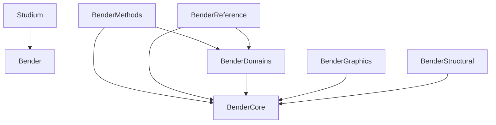

# Bender Architecture

## Package Responsibilities
- `bender.core`: Mechanics-agnostic foundation. Defines identities, traceability, mathematical IR, provenance, diagnostics, conventions, and generic registries.
- `bender.domains`: Specific mathematical theories (e.g., beam_planar, frame2d). Defines grammar and types, but not solvers.
- `bender.methods`: Concrete pedagogical solver implementations for different domains.
- `bender.reference`: Independent solvers for checking/validation.
- `bender.structural`: Graph topology layer.
- `bender.graphics`: Visual representation mappings and bindings.
- `bender.verification`: Invariant checks, tracing validation, cross-method comparison.
- `bender.generation`: Task synthesis, template processing.

## Dependencies

### Allowed
- `studium` can depend on `bender`.
- `bender` components can depend on `bender.core`.
- `bender.methods` can depend on `bender.domains`.
- `bender.reference` can depend on `bender.domains`.

### Forbidden
- `bender` cannot depend on `studium`.
- `bender.core` cannot depend on `bender.domains`, `bender.methods`, `bender.reference`, or `bender.adapters`.
- `bender.methods` cannot depend on `bender.reference`.
- `bender.reference` cannot depend on `bender.methods`.
- `bender.graphics` cannot depend on `bender.methods` or `bender.reference`.
- `rendering` cannot depend on `mechanics solvers`.

## Architecture Diagram

## Problem Lifecycle
1. `ProblemDefinition`: Author-facing definition.
2. `NormalizedProblem`: Canonical immutable definition.
3. `MethodProblemView`: Adjusted projection for a specific solver method.

## Didactic / Reference Split
Didactic Solvers (`MethodSolver`) provide explicit causal step-by-step traces explaining the exact pedagogical algorithm. Reference Solvers (`ReferenceSolver`) silently verify state for cross-checking without polluting didactic output.

## Graphics Boundary
`GraphicsCore` is generic. Solvers map states to `GraphicsBundle`. No mechanical deductions happen in Graphics.

## Registry Model
Open-ended. Methods, Domains, and Graphics extensions register without needing core changes.

## Provisional Abstractions
We intentionally leave abstractions generic until domains stress-test them.
